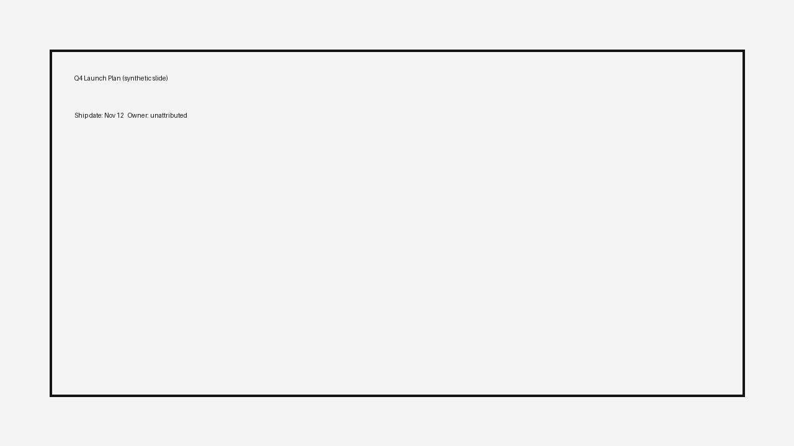

# Q4 Launch Sync (synthetic example)

**Date:** 2026-10-01 | **Duration:** 00:01 | **Goal:** settle the launch date

## TLDR

The group settled the Q4 launch date. One concern about the QA window was raised and not resolved. No action owners were confirmed.

## Significant findings

- Alex opened by asking for a launch date decision [00:04].
- A second speaker (unattributed) flagged risk in the QA window but accepted November 12 [00:19].

*Plan slide shown on screen [00:19]*

## Decisions

- Ship on November 12 [00:41].

## Open questions

- Is the QA window long enough? [00:19]

## Action items

| Owner | Action | Due |
|---|---|---|
| unattributed | Confirm QA window | not stated |
